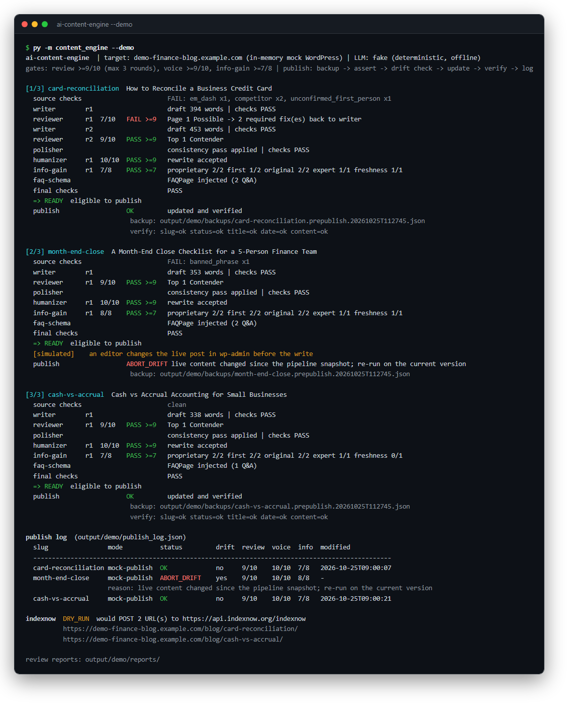
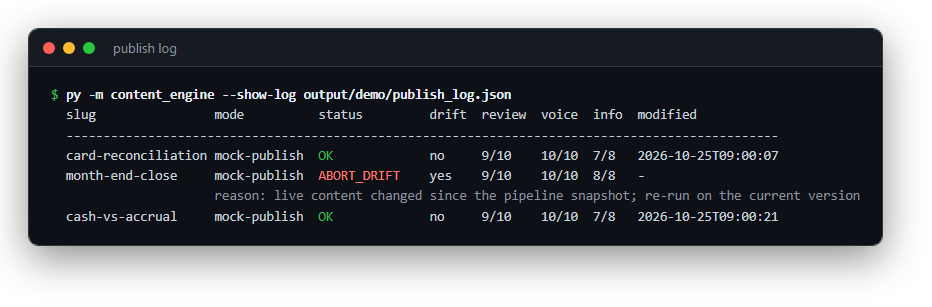
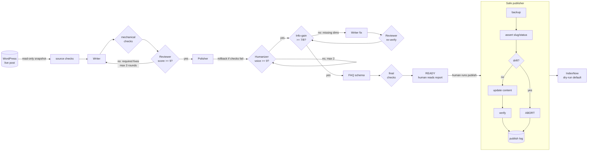
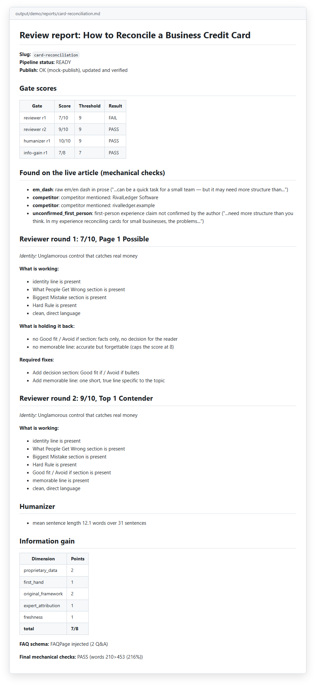
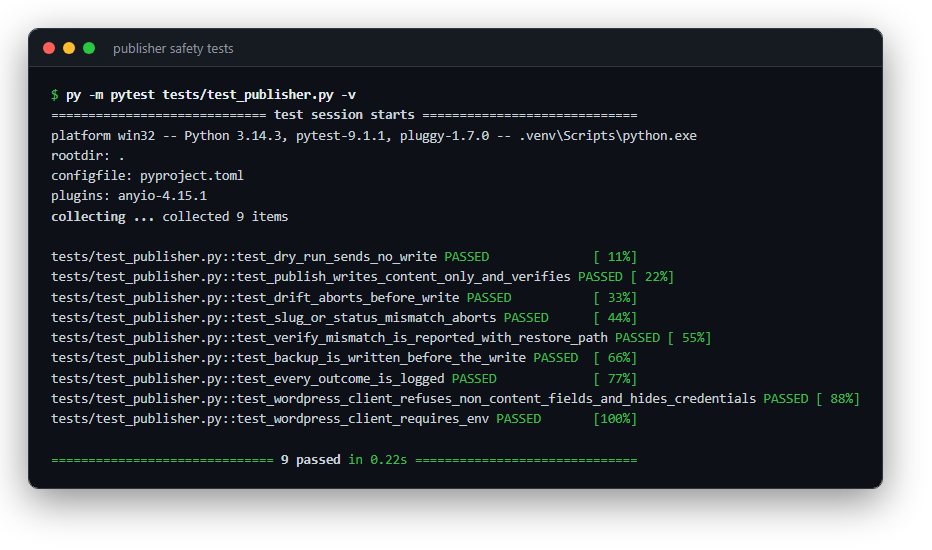

# ai-content-engine

**A five-agent editorial team with quality gates it can't skip, and the controls I'd put on a journal-entry import: back up before every write, verify after it, log everything.**


*The offline demo: three synthetic small-business finance articles go through every gate. One fails review at 7/10 and is sent back with fixes. One is stopped by the drift check. Two publish with backups and a verified write.*

I built the production version to upgrade Aquarium Store Depot, an affiliate blog I own, for Google's helpful-content era and for AI search. The pipeline cataloged 753 posts and has rebuilt about 215 species guides so far, across 7 of 20 topic pillars. A 10-page live pilot passed post-publish verification on all 10 pages, and a 20-page batch shipped with per-page scores. This repo is a clean reference version of that pipeline. It runs fully offline on synthetic data.

## The problem

Upgrading hundreds of live pages with AI is a high-volume write process against a system of record. Skip review and the output comes out generic, and Google's own guidance treats scaled, unreviewed content as a risk. Skip the controls and sooner or later a script overwrites a fix an editor made that morning, or changes a URL that AI answers already cite.

So the writing gets an independent reviewer with a hard pass mark. The publishing gets the discipline I'd use posting to a ledger: a backup before the write, a check that nobody touched the record since you read it, verification after, and an audit trail.

## What it does

- **Five separate agents**, each with its own prompt in [`content_engine/prompts/`](content_engine/prompts): Writer, then Reviewer (must score **9/10 or more** on E-E-A-T, accuracy and decision value), then Polisher, then Humanizer (voice score **9/10 or more**), then the Information-gain judge (**7/8 or more**).
- **Critic, fixer, verifier loops.** A failed review sends its required fixes back to the writer as the next brief. Mechanical failures are added to that brief. A fix made for information gain is re-scored by the reviewer before it counts.
- **Mechanical checks in code**, so the model doesn't grade its own homework: raw em dashes in prose, banned phrases, competitor names and links, first-person "I've run this close" claims the author has not confirmed, invalid JSON-LD, and preservation against the live original (words, images, links, headings).
- **Safe WordPress publisher** using the REST API with an Application Password from environment variables. Each publish runs backup, assert, drift check, content-only update, verify, log. Dry-run is the default.
- **FAQPage JSON-LD injector** that builds the schema only from the visible FAQ, and does nothing if the post already has one.
- **IndexNow submitter** for Bing and Copilot, with a host allowlist, batching and bounded retries. Dry-run is the default.
- **The same team as Claude Code subagents** in [`.claude/agents/`](.claude/agents) (`writer`, `reviewer`, `polisher`, `humanizer`, `info-gain-judge`), with an orchestration guide in [`CLAUDE.md`](CLAUDE.md).
- **LLM calls through the Anthropic SDK** when `ANTHROPIC_API_KEY` is set. The default model is `claude-haiku-4-5` for the cheap judges, and both writer and judge models are configurable. Without a key, a deterministic fake LLM runs the whole pipeline offline.

## Controls

| Control | How it's enforced |
|---|---|
| Score gates | Thresholds live in one place (`config.Gates`). Review is 9/10 or more, voice 9/10 or more, information gain 7/8 or more. An 8 is not a 9 (tested). |
| Scores are recomputed, not trusted | Judge scores are clamped to their range, and the info-gain total is summed by code from clamped dimensions. A judge reporting 99/10 or 50 points on a 2-point dimension gets nothing extra (tested). |
| Bounded loops | Review max 3 rounds, humanizer max 2, info-gain max 2. When a bound is hit the article is **BLOCKED** with a reason and nothing downstream runs (tested). |
| Separation of duties | The writer never grades itself. The reviewer and judges cannot edit. The humanizer's self-score is overridden to 6 if code finds a machine tell in its rewrite (tested). |
| Rollback of a bad late edit | If the polisher breaks a mechanical check (for example by dropping a heading), its edit is discarded (tested). |
| No fabricated experience | First-person experience claims fail the checks unless the author notes confirm them. The honest disclosure ("I haven't run this myself") passes. |
| Backup before write | The live record is saved to disk before any assertion or write. A test hooks the mock's update call and fails if no backup exists yet. |
| Identity assertion | The live slug must match and the status must be `publish`, or the run aborts with no write. |
| Drift check | If the live content differs from the snapshot the pipeline worked from, the run aborts. It never overwrites an edit it hasn't seen. |
| Dry-run by default | Nothing is written unless you pass `--publish`. URLs are not submitted unless you pass `--submit`. |
| Content-only writes | The client refuses to send any field other than `content`. Title, slug, date and status are never sent. |
| Post-write verification | Slug, status, title and date must be unchanged, and the content must match what was sent. A mismatch is reported with the backup path to restore from. |
| Audit log | Every outcome, including dry runs and aborts, is appended to `publish_log.json` with scores, the drift flag, the backup path, the verify results and a timestamp. |
| Human in the loop | Agents never publish. A person reads the review report and then runs `--publish`. "Claude drafts, a human posts." |
| No secrets in code | Credentials come only from environment variables (or a git-ignored `.env`). See [`.env.example`](.env.example). |


*The publish log is the audit trail. Every attempt is recorded, including the one the drift check refused.*

## Architecture




*Each article gets a review report: gate scores per round, what the checks found on the live page, the reviewer's required fixes, and the information-gain breakdown.*

## Quickstart

Demo mode needs no keys. Everything runs offline. The demo uses a fictional small-business finance site (`demo-finance-blog.example.com`) with three synthetic posts (credit card reconciliation, a month-end close checklist, cash vs accrual), an in-memory mock WordPress and the deterministic fake LLM. Output goes to `output/demo/`, which is git-ignored.

Requires Python 3.10+.

**Windows (PowerShell):**

```powershell
git clone https://github.com/markvalderrama001-svg/ai-content-engine.git
cd ai-content-engine
py -m venv .venv
.venv\Scripts\python -m pip install -r requirements.txt
.venv\Scripts\python -m content_engine --demo
.venv\Scripts\python -m content_engine --show-log output/demo/publish_log.json
.venv\Scripts\python -m pytest -q
```

<details>
<summary>macOS / Linux (bash)</summary>

```bash
git clone https://github.com/markvalderrama001-svg/ai-content-engine.git && cd ai-content-engine
python3 -m venv .venv
.venv/bin/python -m pip install -r requirements.txt
.venv/bin/python -m content_engine --demo
.venv/bin/python -m pytest -q
```

</details>

What the demo shows:
- **card-reconciliation**: the live page has an em dash, a competitor link and an unconfirmed "in my experience reconciling" claim. The first draft scores **7/10** and goes back with two required fixes. The second draft scores **9/10**. The page then passes every gate and is published and verified.
- **month-end-close**: passes every gate. Then a simulated editor changes the live post, so the publisher backs it up and **aborts on drift**. Nothing is written.
- **cash-vs-accrual**: passes cleanly at 7/8 information gain (no freshness note supplied) and is published.
- IndexNow runs as a **dry run** for the two published URLs.

Add `--dry-run` to stop before the write even on the mock.

### Real run (your own WordPress)

```powershell
copy .env.example .env      # fill in WP_BASE_URL, WP_USER, WP_APP_PASSWORD, ANTHROPIC_API_KEY
.venv\Scripts\python -m pip install anthropic
.venv\Scripts\python -m content_engine --slugs my-post-slug --notes notes.json            # dry run
.venv\Scripts\python -m content_engine --slugs my-post-slug --notes notes.json --publish  # after reading the report
```

`notes.json` holds the author's confirmed material for each slug, in the same shape as [`fixtures/author_notes.json`](fixtures/author_notes.json). It is the only allowed source for first-person content.

### As Claude Code subagents

Open the repo in Claude Code. The five agents in `.claude/agents/` are available as subagents, and [`CLAUDE.md`](CLAUDE.md) gives the orchestration order, the gates and the retry limits. Publishing stays a separate, human-run command.


*The publisher's controls are covered by offline tests: no write in dry-run, drift abort, verify mismatch, backup before write, every outcome logged.*

## Why finance controls fit a CMS

Publishing to a live CMS looks a lot like posting to a general ledger. Records change in batches, other people are editing the same system while you work, and a bad write is expensive to find later. I didn't invent new controls for it. I reused the ones I already trust:

- **Backup before write** is the pre-posting snapshot. You can always restore.
- **The drift check** is optimistic concurrency. Think of refusing to post a journal entry against a balance that moved after you prepared it.
- **Verification after the write** is the tie-out: the system recorded exactly what you sent and nothing else.
- **The publish log** is the audit trail (who, what, when, which scores, where the backup lives).
- **Score gates** work like an approval matrix. Below the threshold nothing moves, and you can't lower the threshold at run time.

## Case study

Before building any of this I ran an AI-search audit on the site, and [`docs/case-study-ai-search-audit.md`](docs/case-study-ai-search-audit.md) is the sanitized write-up. It used Google Search Console (488K clicks and 57.4M impressions over 16 months, plus 247K AI impressions), Bing Copilot (780.8K citations across 545 pages) and GA4. It explains how the sources were reconciled, what AI actually cites, and the P1 to P8 action plan, including which plan items were dropped after checking current guidance.

## Project structure

```
ai-content-engine/
├── content_engine/
│   ├── prompts/              writer, reviewer, polisher, humanizer, info_gain_judge (.md)
│   ├── agents.py             agent definitions and output parsers
│   ├── orchestrator.py       gates, bounded loops, rollback, final verifier
│   ├── mechanical.py         em dashes, banned phrases, competitors, first-person claims, preservation
│   ├── llm.py                Anthropic backend + backend selection
│   ├── fake_llm.py           deterministic offline stand-in for all five agents
│   ├── wordpress.py          REST client (Application Password from env) + in-memory mock
│   ├── publisher.py          backup -> assert -> drift -> update -> verify -> log
│   ├── faq_schema.py         FAQPage JSON-LD from the visible FAQ
│   ├── indexnow.py           IndexNow submitter (dry-run default)
│   ├── reports.py            console output, review reports, log table
│   └── cli.py                --demo, real runs, --show-log
├── .claude/agents/           the same team as Claude Code subagents
├── CLAUDE.md                 orchestration guide for Claude Code
├── fixtures/                 synthetic demo site, posts and author notes
├── tests/                    offline pytest suite (39 tests)
├── docs/                     case study and screenshots
├── .env.example
└── pyproject.toml / requirements.txt
```

Independent project. Not affiliated with or endorsed by WordPress, Google or Microsoft (Bing); names are used only to describe what the code connects to.

---

**About.** Mark Valderrama, CPA · Finance Engineer. I run the production version in my own businesses. [LinkedIn](https://www.linkedin.com/in/markvalderrama/)

MIT License, see [LICENSE](LICENSE).
